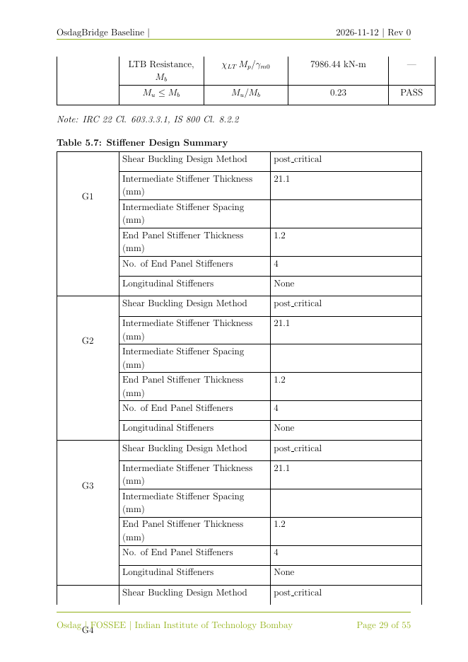
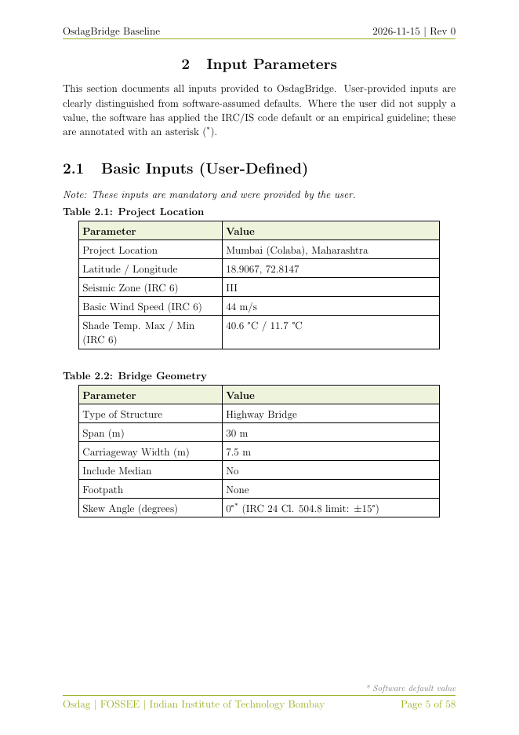
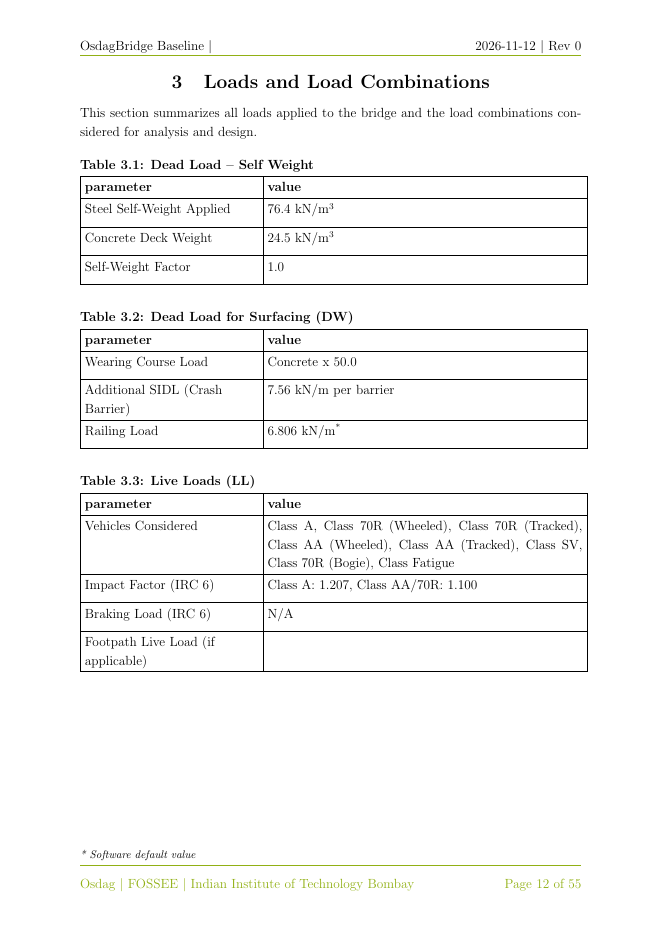
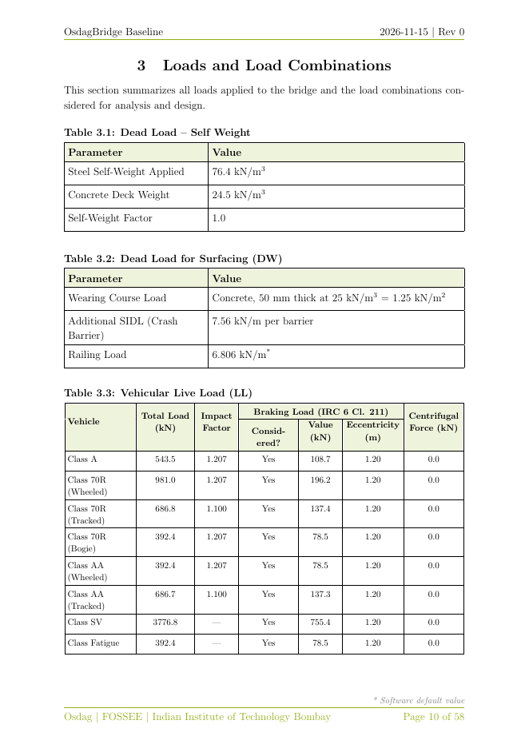
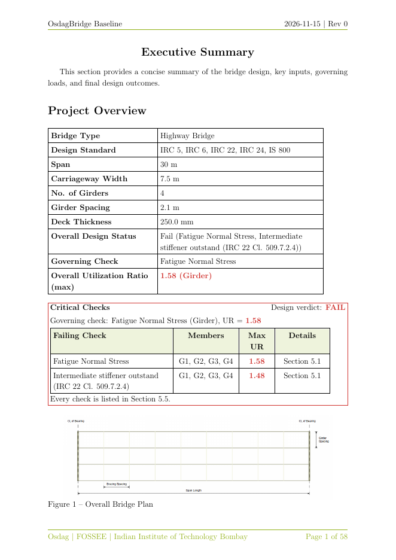
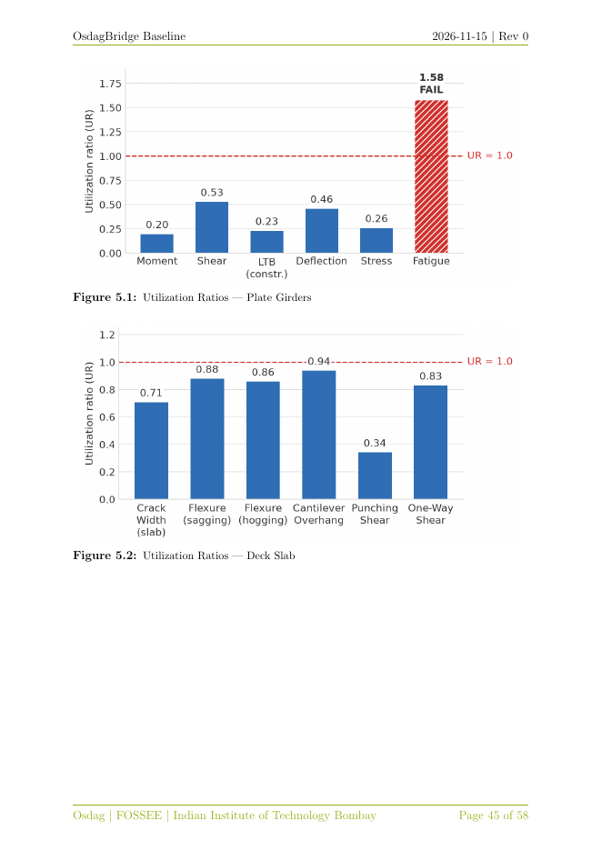
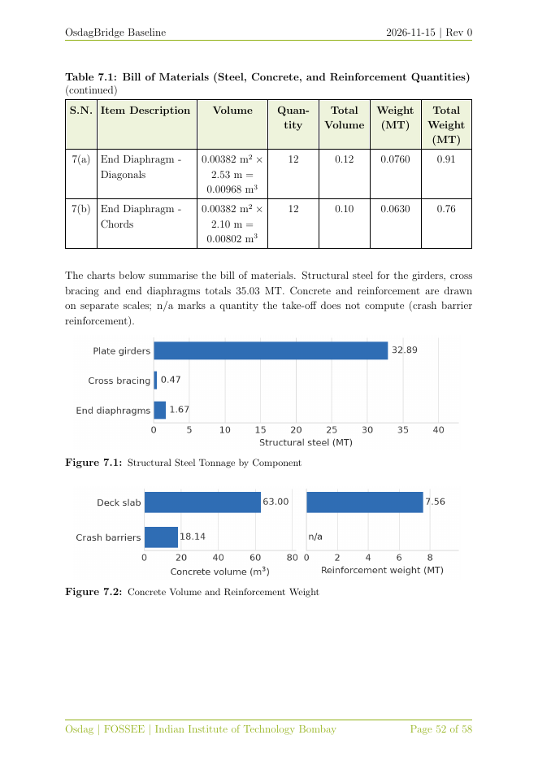
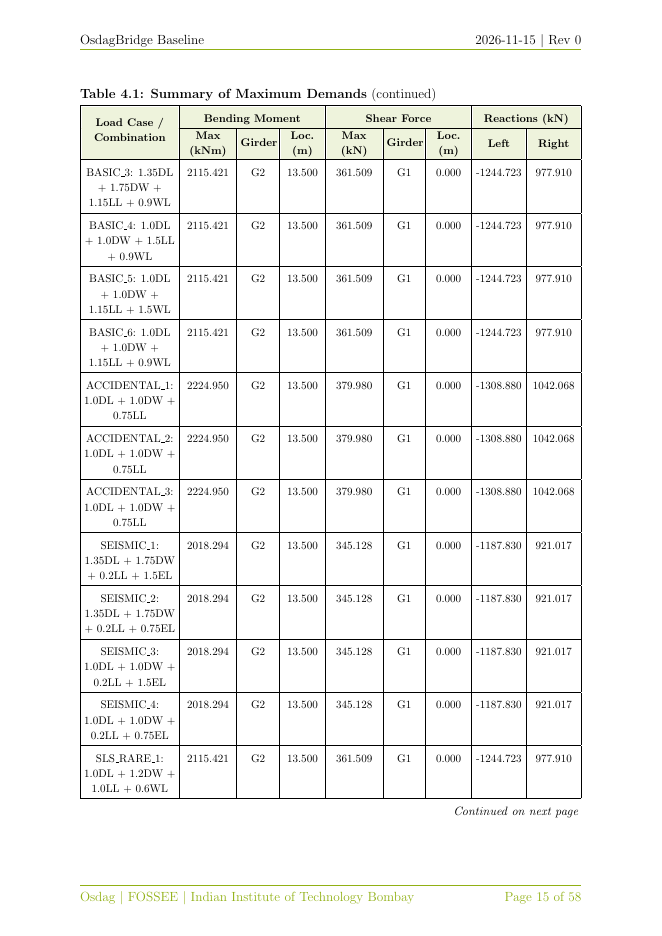

# OsdagBridge design report: technical changes

Branch `report-enhancements`: 88 commits of code and tests on top of `upstream/dev`, plus this document.
`Report_Before.pdf` and `Report_After.pdf` in this folder were built from the same inputs (span 30 m, carriageway 7.5 m, Mumbai (Colaba), all other inputs at their defaults) with the same script, so every difference between them comes from the code changes below.

| | Before | After |
|---|---|---|
| Pages | 56 | 63 |
| Long tables that repeat their header on a new page | 2 of 49 | 51 of 51 |
| Rows running into the footer | page 30 (G4 stiffener row) | none |
| Charts | none | 5 (3 utilization, 2 material) |
| Automated tests for the report | none | 39 |

The extra pages come from the new List of Figures and List of Tables, the charts, the end diaphragm rows, the design log chapter and Table 5.1, which now gives each girder its own page instead of breaking a girder's rows across two.

## Before and after

| Before | After |
|---|---|
|  |  |
| Page 30: the "G4" label hangs into the footer | The stiffener table breaks between girders and repeats its header |
|  |  |
| One live load table, braking "N/A", footpath load blank | Vehicle table (one row per ticked vehicle) and a separate footpath table |

| After only | |
|---|---|
|  |  |
| Critical Checks box on the first summary page | Utilization ratio chart, Section 5.5 |
|  |  |
| Material quantity charts, Chapter 7 | A continued table with its caption and header repeated |

## How to build and check a report

```bash
python tools/build_sample_report.py sample.pdf --keep-build build/
```

The script opens the application, enters the main inputs, runs Design and then Generate Report, so the PDF goes through the same code as a user's report. `--keep-build` keeps the `.tex`, `.log` and chart images; `--preview` builds a watermarked preview; `--main-input KEY=VALUE` sets a main-page field before Design (footpath, median, skew, material grades); `--set-input KEY=JSON` changes an input that only the report reads (used to check that the live load tables follow the Loading tab).

```bash
python -m pytest tests
```

`tests/integration/test_report_latex.py` compiles a short document with the bundled pdflatex (title page, executive summary, a table that breaks across pages, a chart and the design log), using a project name full of characters LaTeX treats specially. It is skipped when no pdflatex is found.

## Item 6: central style module

`src/osdagbridge/core/reports/styles.py` now holds every layout and theme value that the chapters used to repeat as literals:

| Class (instance) | What it holds |
|---|---|
| `PageStyle` (`PAGE`) | paper, font size, margins, header height, footer distance |
| `Palette` (`COLORS`) | brand green, table header tint, PASS/FAIL and log colours |
| `TableStyle` (`TABLE`) | column gaps, row padding, rule width, "continued" labels |
| `SpacingScale` (`SPACING`) | the three vertical gaps used between blocks |
| `FigureStyle` (`FIGURE`) | figure widths and caption spacing |
| `ChartStyle` (`CHART`) | chart colours, size and font |
| `Typography`, `TitlePageStyle`, `HeaderFooterStyle` | headings, title page, running header and footer |

`latex_definitions()` turns these values into named LaTeX lengths, colours and macros (`\rowpad`, `\tablegap`, `\statuspass{}`, `\statusfail{}`, `\groupcline`), and the chapters use only those names. Changing a margin, a colour or a row gap is now a one-line edit. While moving the values, four leaks were fixed: a `\tabcolsep` change in Section 2.2 that carried into every later table, a caption gap from Chapter 2, chapter headings losing their format when the table of contents is turned off, and a second chapter-heading definition in the executive summary.

## Item 1: table headers repeat across page breaks

All 51 long tables now open with `longtable_begin()` in `tables.py`. It writes the caption and header once for the first page (`\endfirsthead`), repeats both under a "(continued)" caption on every following page (`\endhead`), ends each broken page with "Continued on next page" (`\endfoot`), and narrows the column widths when a table would run past the text block. Before this, 45 of the tables were wider than the page once column gaps were counted.

Grouped tables (one block of rows per girder or per bracing panel) use `group_rows()`. Rows inside a group end in `\\*`, which forbids a page break, and the rules between them use `\groupcline`, a copy of `\cline` that cannot be broken after. When a group does not fit at the bottom of a page, the whole group moves to the next page with its label.

## Item 2: footer overlap and vertical spacing

Cause of the page 30 overlap: the footer rule sat about 6 pt below the last text line, and the stiffener table broke inside the G4 group, so the centred "G4" label hung below the cut and into the footer.

- `headheight` and `footskip` are now set in the page geometry. This also removed 54 fancyhdr warnings.
- The footer rule moved clear of the text block, and the "software default value" note now sits just above the rule, inside the footer.
- Grouped tables no longer break inside a group (see Item 1).
- Cell padding was rebalanced so single-line rows sit in the middle of the row.

## Item 3: vehicle and footpath live loads

`live_loads.py` builds the rows and `chap3.py` only formats them. The single mixed table became two.

The Vehicular Live Load table has one row per vehicle ticked in Additional Inputs > Loading, custom vehicles included, with columns for total load (kN), impact factor, braking load (considered?, value in kN, eccentricity in m) and centrifugal force (kN). Impact factors follow IRC 6 Cl. 208.2 for Class A and wheeled custom vehicles and Cl. 208.3 for Class AA, 70R and tracked vehicles. Braking is 20 % of the first train (Cl. 211.2), applied at the eccentricity entered in the Loading tab.

The Footpath Live Load table gives whether a footpath exists, its width, the pressure basis (IRC 6 or a user value) and the load in kN/m².

`IRC6_2017.cl_208_3_impact_factor` gained an optional `tracked` argument so the table can give each vehicle its own factor; its default behaviour is unchanged. A note under the table states the factor the grillage analysis applies today, because the analysis does not use the per-vehicle selection (see "Backend issues").

## Item 4: utilization ratio charts in Section 5.5

The rows of the Overall Design Check Summary are now `SummaryRow` records with a numeric UR, and the table and the charts are both drawn from that list, so they cannot disagree. `charts.py` draws one column chart per element group (plate girders, deck slab, cross bracing, end diaphragms), with the utilization ratio on the y-axis and a red dashed horizontal line at UR = 1.0. Failing bars are red, hatched and labelled FAIL, so they still read in greyscale print and for colour-blind readers. A group with no UR (rolled or welded end diaphragms have no design check yet) gets one sentence instead of an empty chart.

The bundled TeX has no pgfplots, so the charts are matplotlib PNGs. They are drawn with matplotlib's object interface (`Figure`), which can run on the report thread while the Qt window is open; pyplot keeps global state and is not safe there.

## Item 5: material quantity charts in Chapter 7

The bill of materials had no end diaphragm rows. `boq_generator.end_diaphragm_quantities()` adds them as item 7: one diaphragm at each support of every girder pair, read per support end. Cross bracing diaphragms give chords and diagonals (diagonal length from the girder spacing and the 0.85 × girder depth bracing height the end diaphragm design uses; a double angle counts as two angles), and rolled or welded beam diaphragms give one beam each. Members of different sizes get their own row, so quantity × unit weight always equals the total.

Chapter 7 then shows two charts under the table: structural steel tonnage for girders, cross bracing and end diaphragms, and concrete volume (m³) next to reinforcement weight (MT). The second chart uses two panels with separate scales rather than one chart with two y-axes, because two scales on one axis invite comparing bar heights that have different units.

## Fixes after a page-by-page review

The finished report was read page by page in a PDF viewer at normal screen zoom. Each fix below is in the shared report code, so it applies to every table and page.

### Rules of different weights

longtable draws every `\hline` twice, one copy on each side of a possible page break. The two copies overlap exactly in the PDF, and at screen zoom a doubled line renders darker than the single vertical rules and `\cline`s next to it. `styles.py` now redefines longtable's rule so it is drawn once, with the page break after it. The header shading had a related problem: colortbl paints a cell's fill after the rules above and to the left of it, and viewers round fills out to whole pixels, so the fill covered part of those rules. The fill now stops one rule width short of every rule in the first header row; a second header row (`\tableheadernext`) fills to the top so a cell spanning both rows stays one colour. All rules are 0.75 pt, one screen pixel at 100 % zoom.

### Tables split badly across pages

`keep_rows_together()` in `tables.py` runs over the finished document. A table of six rows or fewer moves to the next page whole; a longer table is never broken after its first row or before its last, so no page carries one stray row. `\\*` alone was not enough, because longtable's `\hline` is itself a break point, so the rule after a locked row becomes `\hlinenobreak`.

### Half-empty pages

Five forced page breaks inside Chapters 2, 5 and 8 left the page before them mostly blank. They were removed; the sections and tables now follow on with the usual table gap.

### Header words running out of their columns

TeX never hyphenates the first word of a paragraph, so a long single heading such as "Longitudinal" ran over the column rule. The L, C and R column types now start with `\hspace{0pt}`, which lets that word hyphenate. The bracing capacity tables got wider Member and Section columns, and Table 1 in the executive summary is fitted to the text width like the other tables (it was 12.6 pt too wide).

### Drawings far from their captions

The six section previews in Chapter 6 are 300 × 300 px widget captures with the drawing in a small part of them. They are now cropped to the drawing and capped at 3.5 cm high, so Figures 6.8 to 6.14 sit directly above their captions.

### Formulas touching the rule above

A square root or stacked fraction is taller than a line of text, so it pushed against the rule above its row. `\tallcell{}` adds a 3 pt gap above such a cell only; ordinary rows keep their height.

### Checked with other inputs

To find values written into the report code, reports were also built for other locations and settings with `tools/build_sample_report.py`:

| Location | Span, carriageway | Other inputs |
|---|---|---|
| Ahmedabad, Gujarat | 40 m, 11 m (3 lanes, 5 girders) | footpaths on both sides, 10° skew |
| Dhubri, Assam (seismic zone V) | 25 m, 7.5 m | footpath on one side |
| Chennai, Tamil Nadu | 35 m, 9 m | median; 70R wheeled, 70R bogie and fatigue vehicles unticked; no Class SV braking; braking eccentricity 1.5 m |
| Bagalkote, Karnataka | 30 m, 7.5 m | M35 deck concrete |

All four compiled without LaTeX errors. Location values (seismic zone and zone factor, wind speed, shade temperatures), lane count, girder count, footpath and median rows, the vehicle table and the impact factors all followed the inputs. The runs found three things, now fixed: the bill of materials printed "M40" and "Fe 500" whatever grades were chosen, computed widths printed as 15.649999999999999, and chart labels such as "Compression" were split mid-word.

### Smaller fixes

- The vehicle load note broke across a page right after "Impact factor = 1 +". It is now kept in one piece, and "1 + IM" cannot be split.
- The header text of shaded rows sat one space to the right of the body text.
- Page numbers: roman numerals for the contents and lists, and "Page n of N" counted from the executive summary.
- Two labels named `sec:assumptions`; one is renamed.
- Unbreakable clause references that ran past the margin.

## Additional changes

| | Change | Why |
|---|---|---|
| A1 | Report defects: stable Chapter 4 load case order, no "-0.000", computed wind Vz and Pz shown, wearing course load in kN/m², units in the summary, 0° skew shown when none is entered, stiffener sizes labelled "required" in Optimized mode, readable stiffener check names, no stray "\|" in the header, crash barrier volume | Each was wrong or blank in the old report |
| A2 | Green PASS and bold red FAIL in every check table, UR above 1.0 highlighted everywhere | 65 of 80 PASS cells were plain text, and the old red was below the 4.5:1 text contrast minimum |
| A3 | Critical Checks box on the first summary page: verdict, governing check, each failing check with its girders, highest UR and a link to its section | A reviewer sees the outcome without paging through the report |
| A4 | "PREVIEW --- NOT FOR CONSTRUCTION" watermark on reports from the Preview button | A printed preview cannot pass as an issued report |
| A5 | List of Figures, List of Tables, numbered plot captions, PDF title/author/subject, bookmarks opened at chapter level | Navigation in a long document |
| A6 | "Summary charts" item in the report options | Users can leave the charts out |
| A7 | 39 tests: style module, table helper, charts, live load selection, end diaphragm quantities, executive summary, design log, LaTeX compilation | The report had no tests |
| A8 | `tools/build_sample_report.py` | Reproducible sample reports for before/after comparisons |

Defects in existing code found and fixed on the way:

- The report options let users untick Chapters 7 to 10, but the generator always included them; the Design Log chapter was built and then thrown away. Both now follow the ticks, and the design log is printed.
- The crash barrier area was divided by 10⁶ a second time, so its volume was 0.00. The Additional Inputs field holds m²; the plate girder defaults store mm², and the bill of materials now accepts both.
- The executive summary counted the two edge-beam grillage lines (G5 and G6 for a four-girder bridge) as girders.
- Chapter 7 opened a `\begingroup` that was never closed, so its tight column spacing carried into Chapter 8.
- The End Diaphragm property table was filled with cross bracing data, and two member property tables declared more columns than they filled.
- `≤` in check names stopped pdflatex.

## Backend issues found (not report code)

These are outside the report generator and are left for separate issues:

1. `IRC6_2017.cl_211_2_braking_force` raises `UnboundLocalError` for one or two lanes (`braking_force_2` is never set). The old report printed "N/A" for braking because of this.
2. `cl_208_3_impact_factor` tests `KEY_VEHICLE[1]`, a non-empty string, so it always returns the tracked-vehicle value. The analysis applies 1.100 to every vehicle case, including Class A, where Cl. 208.2 gives 1.207 at a 30 m span.
3. The grillage analysis loads only the Table 6A Class A / 70R combinations; the vehicle ticks and braking inputs of the Loading tab do not reach the analysis.
4. The end diaphragm design finds no member force above its tolerance, so `end_diaphragm_design_results` is empty and no end diaphragm member checks are reported.
5. `defaults.py` stores the crash barrier area in mm² while the Additional Inputs field and its compute function use m².
6. `defaults.py` writes the girder depth in mm, while the bracing designs read the same key as metres.
7. With a 10° skew (40 m span, 11 m carriageway, five girders) `get_results_dataset()` returned nothing, so the backend stored no load case summary and the per-girder fatigue and deflection results held only G1. Table 4.1 now says no grillage results are available instead of showing a row of dashes.
8. Changing the Footpath dropdown raises `AttributeError` in `input_dock.py`: `CustomWindow` has no `notify_additional_inputs_footpath`.

## Known limits

- In `array` and `longtable`, the padding after a row is measured from the row's first line, so a row whose text wraps gets less space below it than a single-line row. Fixing this means patching LaTeX internals (`\@array`, `\LT@array`); not worth the risk.
- Table 5.1 lists 13 properties per girder and now takes one page per girder, because a girder block no longer breaks across pages. Other per-girder tables in Chapter 5 leave part of a page empty for the same reason.
- Rules are all drawn at the same width, but at some zoom levels a viewer rounds a 0.75 pt line to one pixel and the next one to two, so one line can look a shade heavier than its neighbours. The difference comes from the screen; printed, the lines look the same.
- Rolled and welded end diaphragms have no design check in the backend, so they have no utilization chart.

## Files

| File | Change |
|---|---|
| `core/reports/styles.py` | new: style module |
| `core/reports/tables.py` | new: long table opening, width fitting, grouped rows, page-break control |
| `core/reports/charts.py` | new: utilization and quantity charts |
| `core/reports/live_loads.py` | new: vehicle and footpath load rows |
| `core/reports/report_generator.py` | preamble from the style module, watermark, PDF properties, chapter selection |
| `core/reports/executive_summary.py` | Critical Checks box, readable check names, girder filter |
| `core/reports/chap2.py` to `chap8.py` | tables through `longtable_begin`, style names, the fixes above |
| `core/reports/report_utils.py` | numbered figure captions, `≤`/`≥` handling |
| `core/boq/boq_generator.py` | end diaphragm rows, crash barrier area |
| `core/utils/codes/irc6_2017.py` | optional `tracked` argument for Cl. 208.3 |
| `desktop/ui/dialogs/report_options.py` | preview flag, summary charts item |
| `tests/...` | 39 tests |
| `tools/build_sample_report.py` | sample report script |
